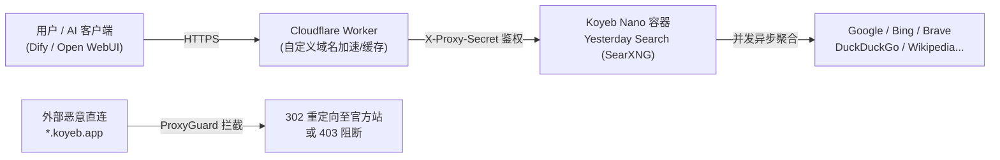

# Yesterday Search 🔍

[](https://github.com/R1tain/yesterday-search/actions/workflows/build-and-deploy.yml)
[](https://github.com/R1tain/yesterday-search/pkgs/container/yesterday-search)
[](https://www.gnu.org/licenses/agpl-3.0)

**Yesterday Search** 是一个专为 **AI 联网搜索（AI Search / RAG）** 与个人隐私检索量身打造的元搜索引擎。基于官方最新的 [SearXNG](https://github.com/searxng/searxng) 深度定制，针对 **Koyeb Free Tier（免费 Nano 实例）** 与 **Cloudflare Edge** 全球边缘网络进行了全栈优化。

---

## 🌟 核心特性

- 🤖 **AI 联网就绪 (AI-Ready)**：原生开放结构化 JSON 输出（`format=json`），完美兼容 Dify、Open WebUI、LangChain、LobeChat、Cherry Studio 等 AI 客户端与 Agent 框架。
- 🔄 **每日全自动静默交付**：GitHub Actions 每天上午 11:00（UTC 03:00）自动抓取官方最新的反爬虫与引擎修复补丁，构建后通过 Koyeb REST API 自动实现**零停机滚动更新**。
- 🛡️ **ProxyGuard 后端防探隔离**：内置安全握手中间件，拒绝公网直连访问 Koyeb 后端域名（自动 302 重定向至官方前端或 403 阻断），强制收敛至 Cloudflare 防护体系。
- ⚡ **极致性能与免费托管**：实测内存占用仅 ~120MB（远低于 Koyeb 免费 Nano 档位 512MB 限制），前置 Cloudflare Worker 缓存毫秒级响应。
- 🎨 **极简原生单色排版**：严格对照 SearXNG 原生优雅风范，采用品牌纯文字 `#487cff` 科技蓝字形，去除一切多余杂质。

---

## 🏗️ 架构拓扑



---

## 🚀 部署配置指南

完整部署由两部分组成：**后端容器（Koyeb）** 与 **前端边缘反代（Cloudflare Worker）**。

### 第一部分：部署 Koyeb 后端实例

1. 登录 [Koyeb 控制台](https://app.koyeb.com/)，点击 **Create Service**。
2. 选择 **Docker Image** 部署模式：
   - **Image**: `ghcr.io/r1tain/yesterday-search:latest`
   - **Instance Type**: `Nano`（免费档位：0.1 vCPU / 512MB RAM）
   - **Exposed Port**: `8080` (HTTP)
3. 在 **Environment Variables** 添加以下环境变量：

| 变量名 | 推荐设定值 | 说明 |
| :--- | :--- | :--- |
| `SEARXNG_BASE_URL` | `https://search.yourdomain.com/` | 你的前端公开主域名（末尾必须带斜杠 `/`） |
| `SEARXNG_SECRET` | 随机生成 32 位 Hex 字符 | 会话与 Cookie 加密密钥 |
| `GRANIAN_WORKERS` | `1` | 适配 Koyeb Nano 单核限制 |
| `GRANIAN_BLOCKING_THREADS` | `2` | 异步 IO 阻断线程数 |

4. 点击 **Deploy**，部署成功后复制分配的域名（例如 `your-app-subdomain.koyeb.app`）。

---

### 第二部分：部署 Cloudflare Worker（边缘加速与反代）

项目在 [`cloudflare/`](cloudflare/) 目录中已内置全套生产就绪的 Worker 脚本代码与配置文件。

#### 功能作用：
- **全球边缘加速**：自动缓存 CSS、JS、字体与图片，响应速度可达个位数毫秒。
- **冷启动容错**：若后端容器睡眠或重载，自动执行 3 次重试并展示优雅的启动过渡倒计时页面。
- **安全握手**：向上游注入 `X-Proxy-Secret` 头，与后端的 ProxyGuard 协同彻底封死 Koyeb 域名的公开暴露。
- **Cookie 完整保留**：多 Set-Cookie 原生穿透，确保用户搜索偏好与主题持久生效。

#### 部署方式 A：Cloudflare 控制台 Web UI（最简便）

1. 登录 [Cloudflare Dashboard](https://dash.cloudflare.com/) ➔ 进入 **Workers & Pages** ➔ **Create application** ➔ **Create Worker**。
2. 命名为 `yesterday-search`，点击 **Deploy**。
3. 点击 **Edit code**，将本项目 [`cloudflare/worker.js`](cloudflare/worker.js) 中的代码完整粘贴并覆盖，点击右上角 **Deploy**。
4. 返回该 Worker 的 **Settings** ➔ **Variables and Secrets** ➔ 添加以下环境变量：
   - `UPSTREAM_HOST`: 填入你的 Koyeb 分配域名，例如 `your-app-subdomain.koyeb.app`（必填，无需加 `https://`）。
   - `PROXY_SECRET`: 填入 `yesterday_search_cf_worker_auth_2026`（必填，需与后端中间件一致）。
   - `ACCESS_TOKEN`: 仅在需要开启**私人专属访问**时配置，留空则为公网全开放。
5. 在 **Settings** ➔ **Domains & Routes** ➔ **Add** 绑定你的自定义域名（例如 `search.yourdomain.com`）。

#### 部署方式 B：Wrangler CLI（本地命令行）

```bash
cd cloudflare

# 1. 复制配置文件模板
cp wrangler.toml.example wrangler.toml

# 2. 修改 wrangler.toml 中的 UPSTREAM_HOST 为你的 Koyeb 域名
# 3. 执行一键发布
npx wrangler deploy
```

---

### 第三部分：配置 GitHub Actions 自动更新流水线

仓库已集成无人值守 CI/CD，每天上午 11:00（UTC 03:00）自动拉取官方最新补丁构建镜像，并免缓存滚动重启 Koyeb 服务。

在 GitHub 仓库 **Settings -> Secrets and variables -> Actions** 中配置：

- `GH_PAT`: 拥有 `write:packages` 权限的 GitHub Personal Access Token（用于推送 GHCR 镜像）。
- `KOYEB_API_TOKEN`: Koyeb 账号的 API Token（在 Koyeb 个人中心 User Settings ➔ API 创建）。
- `KOYEB_SERVICE_ID`: Koyeb 服务的 UUID（可在 Koyeb 服务详情页 URL 或 Settings 复制）。

---

## 🤖 AI 调用与集成指南

### 1. 快速 HTTP 调试
```bash
curl -s "https://search.yourdomain.com/search?q=DeepSeek&format=json" | jq .results[0]
```

### 2. Open WebUI 配置
- **Web Search Engine**: 选择 `searxng`
- **SearXNG Query URL**: 填写 `https://search.yourdomain.com/search?q=<query>`

### 3. Dify (Agent 工作流)
- 启用内置 **SearXNG** 工具；
- **SearXNG Base URL**: 填写 `https://search.yourdomain.com`

### 4. Python / LangChain 调用示例
```python
from langchain_community.utilities import SearxSearchWrapper

# 初始化
search = SearxSearchWrapper(searx_host="https://search.yourdomain.com")

# 执行搜索并返回总结
results = search.run("2026年最新科技突破")
print(results)
```

---

## 🔒 安全与访问控制

- **公共模式（默认）**：所有用户与 AI 可直接访问进行无限制检索。
- **私人专属模式**：在 Cloudflare Worker 中添加环境变量 `ACCESS_TOKEN`。配置后：
  - 外部未授权访客访问返回 `404 Not Found` 伪装不存在；
  - 授权访客首次带口令访问 `https://search.yourdomain.com/?token=<your-access-token>` 自动签发安全 Cookie 即可畅行无阻；
  - AI 客户端可通过 Header `Authorization: Bearer <your-access-token>` 免 Cookie 直连调用。

---

## 📄 开源许可证

本项目遵循 [GNU Affero General Public License v3.0 (AGPL-3.0)](https://www.gnu.org/licenses/agpl-3.0) 开源。
