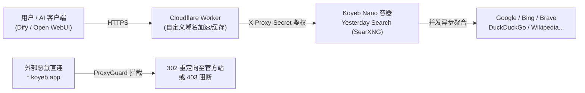

# Yesterday Search 🔍

[](https://github.com/R1tain/yesterday-search/actions/workflows/build-and-deploy.yml)
[](https://github.com/R1tain/yesterday-search/pkgs/container/yesterday-search)
[](https://www.gnu.org/licenses/agpl-3.0)

**Yesterday Search** 是一个专为 **AI 联网搜索（AI Search / RAG）** 与个人隐私检索量身打造的元搜索引擎。基于官方最新的 [SearXNG](https://github.com/searxng/searxng) 深度定制，针对 **Koyeb Free Tier（免费 Nano 实例）** 与 **Cloudflare Edge** 全球边缘网络进行了全栈优化。

---

## 🌟 核心特性

- 🤖 **AI 联网就绪 (AI-Ready)**：原生开放结构化 JSON 输出（`format=json`），完美兼容 Dify、Open WebUI、LangChain、LobeChat、Cherry Studio 等 AI 客户端与 Agent 框架。
- 🔄 **每日全自动静默交付**：GitHub Actions 每天上午 11:00（UTC 03:00）自动抓取官方最新的反爬虫与引擎修复补丁，构建后通过 Koyeb REST API 自动实现**零停机滚动更新**。
- 🛡️ **ProxyGuard 后端防探隔离**：内置安全握手中间件，拒绝公网直连访问 Koyeb 后端域名（自动 302 重定向至官方前端或 403 阻断），强制收敛至 Cloudflare 防护体系。
- ⚡ **极致性能与免费托管**：实测内存占用仅 ~120MB（远低于 Koyeb 免费 Nano 档位 512MB 限制），前置 Cloudflare Worker 缓存毫秒级响应。
- 🎨 **极简原生单色排版**：严格对照 SearXNG 原生优雅风范，采用品牌纯文字 `#487cff` 科技蓝字形，去除一切多余杂质。

---

## 🏗️ 架构拓扑



---

## 🚀 部署配置参考

### 1. 容器镜像信息
- **Registry**: GitHub Container Registry (`ghcr.io`)
- **Image**: `ghcr.io/r1tain/yesterday-search:latest`
- **内部监听端口**: `8080` (HTTP)

### 2. Koyeb 服务环境变量 (Environment Variables)

| 变量名 | 推荐设定值 | 说明 |
| :--- | :--- | :--- |
| `SEARXNG_BASE_URL` | `https://search.yourdomain.com/` | 站点公开主域名（末尾必须带斜杠 `/`） |
| `SEARXNG_SECRET` | 随机强密码（如 32 位 Hex） | 会话加密密钥 |
| `GRANIAN_WORKERS` | `1` | 适配 Koyeb Nano 单核限制 |
| `GRANIAN_BLOCKING_THREADS` | `2` | 异步 IO 阻断线程数 |

### 3. GitHub Actions 自动更新机密 (Repository Secrets)

仓库已集成无人值守 CI/CD 流水线，如需自动构建并触发部署，在仓库 **Settings -> Secrets and variables -> Actions** 中配置：

- `GH_PAT`: 拥有 `write:packages` 权限的 GitHub Personal Access Token（用于登录推送 GHCR 镜像）。
- `KOYEB_API_TOKEN`: Koyeb 账号的 API Token。
- `KOYEB_SERVICE_ID`: Koyeb 上对应的服务 UUID。

---

## 🤖 AI 调用与集成指南

### 1. 快速 HTTP 调试
```bash
curl -s "https://search.yourdomain.com/search?q=DeepSeek&format=json" | jq .results[0]
```

### 2. Open WebUI 配置
- **Web Search Engine**: 选择 `searxng`
- **SearXNG Query URL**: 填写 `https://search.yourdomain.com/search?q=<query>`

### 3. Dify (Agent 工作流)
- 启用内置 **SearXNG** 工具；
- **SearXNG Base URL**: 填写 `https://search.yourdomain.com`

### 4. Python / LangChain 调用示例
```python
from langchain_community.utilities import SearxSearchWrapper

# 初始化
search = SearxSearchWrapper(searx_host="https://search.yourdomain.com")

# 执行搜索并返回总结
results = search.run("2026年最新科技突破")
print(results)
```

---

## 🔒 安全与访问控制

- **公共模式（默认）**：所有用户与 AI 可直接访问进行无限制检索。
- **私人专属模式**：可在 Cloudflare Worker 中添加环境变量 `ACCESS_TOKEN`。配置后，未授权访客访问将显示 `404 Not Found` 伪装不存在，仅凭口令 Cookie 或 Bearer Token 能够使用。

---

## 📄 开源许可证

本项目遵循 [GNU Affero General Public License v3.0 (AGPL-3.0)](https://www.gnu.org/licenses/agpl-3.0) 开源。
